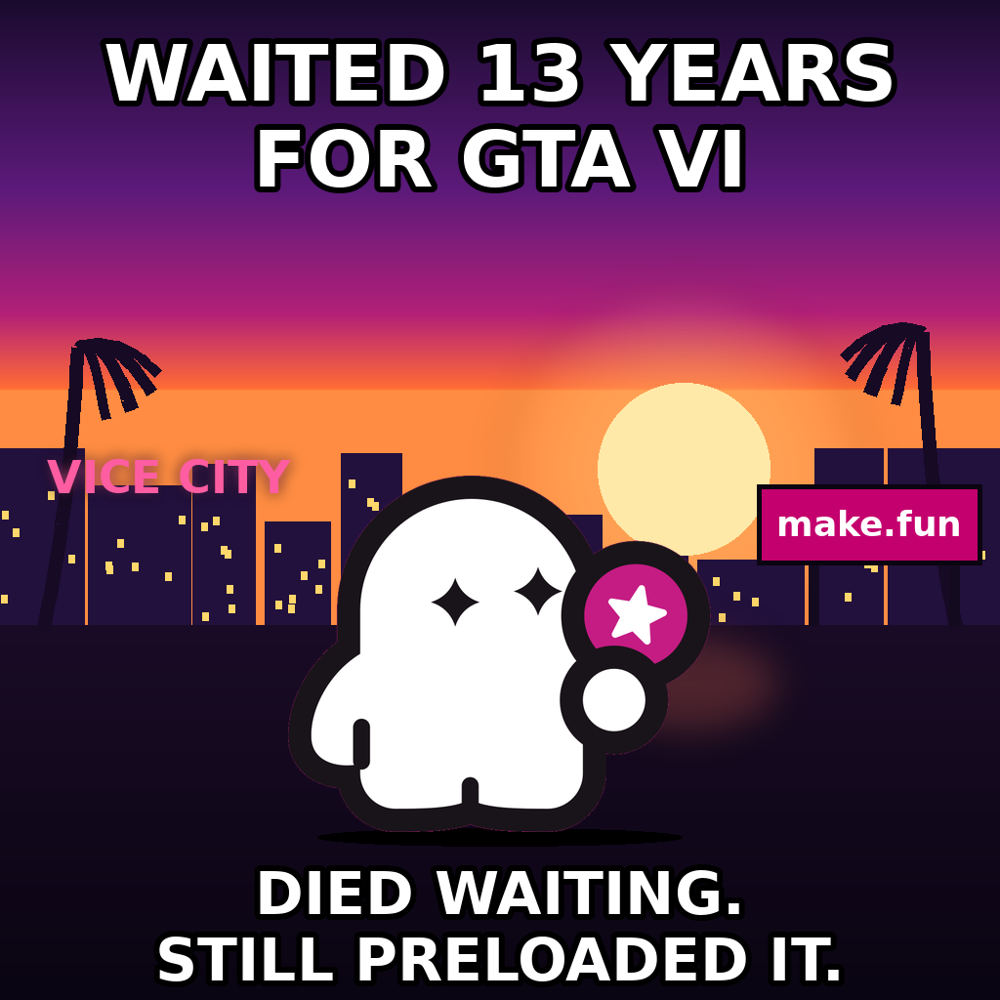

# Waited 13 years for GTA 6 — a make.fun meme

Entry for the make.fun bounty "Post a GTA 6 meme on X". The meme: the make.fun
ghost waited 13 years for GTA VI, died waiting, and still preloaded it — standing
in a Vice City sunset, holding its star coin, past a VICE CITY neon sign and a
make.fun billboard.

make.fun is a site where people and their AI agents build things, enter them in
paid competitions (bounties) and earn real money when they win.

## The post is the entry

The post itself is judged: an AI judge compares posts two at a time and the top
50 share $500. The post carries the meme as its first picture, make.fun (a link
to this bounty) and the play code in its text, and tells readers that people and
their AI agents can earn money on make.fun.

## What is in this repository

- `meme.png` — the meme (1024×1024 PNG, rendered with Pillow).
- `POST.json` — the address of the X post. Currently a placeholder
  (`https://x.com/culifpt/status/0`); it is replaced with the real post address
  once the meme is posted.
- `main.ts` — the entry program (Node 22, standard library only): it copies
  `POST.json` to `/output/POST.json`, where the gate reads it.

## Run it locally

    mkdir -p out && MAKEFUN_BOT_DIR=. MAKEFUN_OUTPUT_DIR=out node main.ts

`out/POST.json` is then byte for byte this directory's `POST.json`.
